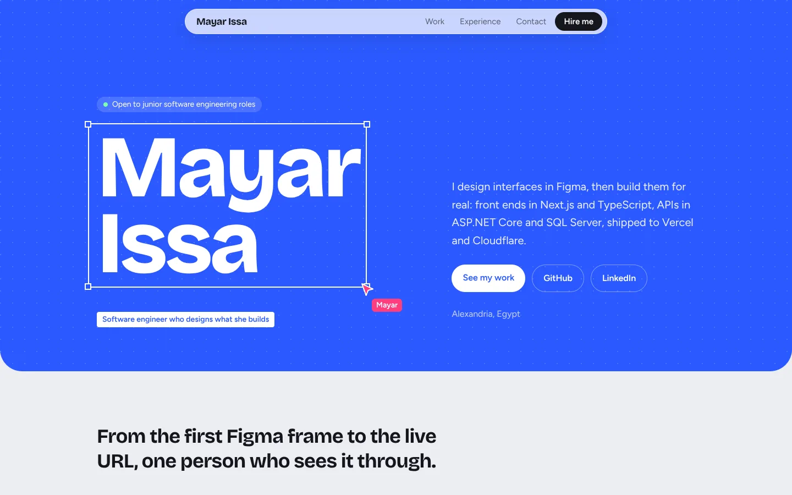

# Mayar Issa — Portfolio

My personal site: the products I've designed and built, my experience, and how to reach me.

**Live:** [mayar-issa.vercel.app](https://mayar-issa.vercel.app)



## What's inside

- A hero where a collaborator's cursor flies in and "selects" my name, the way a layer gets selected in Figma: a nod to how I work, designing first and building second.
- Project cards that show each live site inside a browser window, with what I built, the stack, and links to the live site and code.
- Experience, education, Cisco certificates and skills.

## Built with

Next.js (App Router) · TypeScript · Tailwind CSS · self-hosted Bricolage Grotesque and Figtree fonts · deployed on Vercel

It respects reduced-motion settings, works with a keyboard, and lays out down to small phones.

## Editing

All text lives in `src/content.ts`. To add a project, add an entry to `projects`; to give it a screenshot, put the image in `public/work/` and set `image`.

```bash
npm install
npm run dev    # http://localhost:3000
npm run build
```
